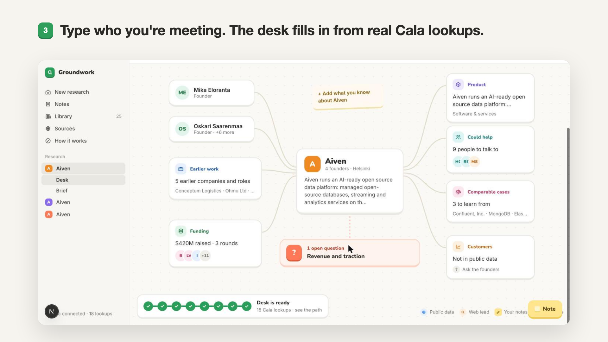

# Groundwork

A research desk for angel and pre-seed investors, built on [Cala](https://cala.ai)'s public data at Junction 2026 (Make Unicorns Real challenge).

You type who you're meeting. Groundwork looks them up in Cala and lays out what's known: the founders and where they worked before, funding and investors, people who could tell you more, similar companies, and what's still unknown. Every fact links to the Cala lookup it came from. It never tells you whether to invest.

## Demo

[](docs/demo.mp4)

**[Watch the 40-second demo (docs/demo.mp4)](docs/demo.mp4)**

What you see: the first-run walkthrough, a research on Aiven, a founder's side panel with sources and a suggested question, the research path with the exact Cala request, the brief, and saving the research together with the company, people and investor profiles.

## Run it

```bash
npm install
cp .env.local.example .env.local   # add CALA_API_KEY (ANTHROPIC_API_KEY and EXA_API_KEY are optional)
npm run dev                        # http://localhost:3045
```

## How it uses Cala

About 10 to 18 queries per company: entity search to find it, introspection to see which fields exist, one retrieval for the profile plus team and funding links, more retrievals for people, investors and earlier employers, and knowledge search for comparables. Requests are paced to the rate limit and cached for three days in `data/cala-cache.json`.

For companies too new to be in Cala, founders-first mode starts from the founders' names and a one-line idea.

Built with Next.js 15, TypeScript, plain CSS, the Cala API, Claude (for the brief) and Exa (optional web leads).
